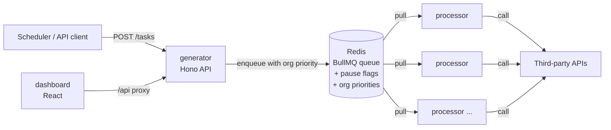
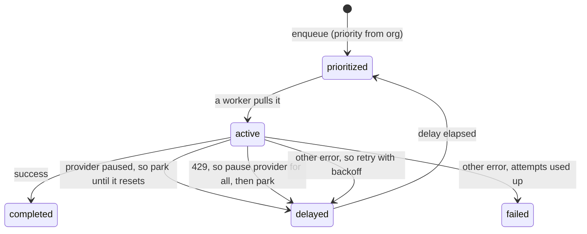
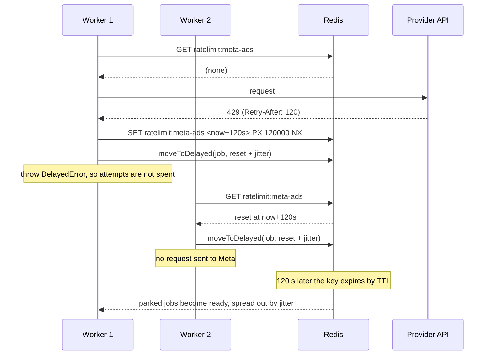

# Pull Queue Case Study

A pull-based job queue for syncing data from **rate-limited third-party APIs**, built with Redis + BullMQ in a TypeScript monorepo.

The queue itself is the easy part. This project is about what happens when a provider says *"slow down"*:

- how to stop **every** worker from hammering that provider, not just the one that got the 429,
- without burning jobs' retry budgets,
- without stalling work for the providers that are fine,
- and without the whole backlog stampeding back the moment the limit lifts.

<!-- Add a dashboard screenshot here: docs/dashboard.png -->

**Contents:** [The problem](#the-problem) · [Why pull](#why-a-pull-queue) · [Architecture](#architecture) · [How it works](#how-it-works) · [Design decisions](#design-decisions) · [Trade-offs](#trade-offs-and-next-steps) · [Running it](#running-it)

---

## The problem

Picture a SaaS product that pulls reporting data from ad and analytics platforms (Google Ads, Meta, TikTok, LinkedIn…) on behalf of many customer organisations. Each sync is a job. The workload has four awkward properties:

| Property | What it means for the queue |
| --- | --- |
| **Bursty** | A scheduler enqueues thousands of jobs at once, e.g. one per connected account at the top of the hour. The queue has to absorb that without overwhelming anything downstream. |
| **Rate-limited per provider** | When Meta returns `429 Too Many Requests`, that's true for *every* Meta job in the queue, not just the one that got it. |
| **Unequal urgency** | A customer who just connected an account wants their first sync now; a historical backfill can wait. |
| **Mixed failures** | Some errors are transient (retry with backoff). Rate limits aren't really failures at all (wait, then try again). |

## Why a pull queue

In a **push** queue, the queue calls an HTTP endpoint for each task and decides how fast to deliver. In a **pull** queue, workers ask for the next job when they have capacity.

| Need | Push (e.g. GCP Cloud Tasks) | Pull (BullMQ on Redis) |
| --- | --- | --- |
| Workers set their own pace (backpressure) | Queue decides the rate | `concurrency` per worker |
| Per-job priority | Limited | Native |
| Park a job until a given time without failing it | Re-enqueue with a schedule time | `moveToDelayed` |
| Shared state between workers ("provider X is paused") | Needs a separate store | Same Redis |
| Workers without a public endpoint | No: needs an HTTP target | Yes: outbound connection only |
| Run everything locally | Emulator workarounds | `docker compose up` |
| Ops burden | Fully managed | You run Redis (or use a managed one) |

GCP's original *pull* queues (App Engine Task Queues) were deprecated in favour of Cloud Tasks, which is push-only. Getting pull semantics on GCP today means Pub/Sub pull subscriptions or running your own broker. Pub/Sub has no per-message priority, so Redis + BullMQ was the better fit here.

**The cost:** you own Redis. It needs persistence (AOF) and `maxmemory-policy noeviction`, or BullMQ can silently lose jobs under memory pressure. The included `docker-compose.yml` sets both.

## Architecture



Everything coordinates through Redis. The generator and processors never talk to each other directly, so either side can be scaled, restarted or deployed independently.

| Package | Role |
| --- | --- |
| [`apps/generator`](apps/generator) | **Producer.** Stateless Hono API: validates and enqueues tasks, sets org priorities, and serves queue state to the dashboard. |
| [`apps/processor`](apps/processor) | **Consumer.** Long-running BullMQ worker that pulls jobs. Run as many as you like. |
| [`apps/dashboard`](apps/dashboard) | React + TanStack Query UI: queue counts, tasks by org and provider, paused providers with countdowns, failed-job details and retry. |
| [`packages/queue`](packages/queue) | `QueueManager` (enqueue with per-org priority), `OrgStateManager`, job options. |
| [`packages/shared`](packages/shared) | Provider list, pause durations, and `RateLimitStore` (the cross-worker pause flags). |
| [`packages/logger`](packages/logger) | Small levelled logger. |

### What lives in Redis

| Key | Type | Written by | Purpose |
| --- | --- | --- | --- |
| `bull:connector-tasks:*` | BullMQ internals | BullMQ | The queue: waiting/prioritized/active/delayed/completed/failed sets and job hashes |
| `org:state:<orgId>` | Hash `{ priority }` | generator | Priority applied to that org's new jobs |
| `ratelimit:<provider>` | String (reset timestamp) + TTL | processor | "This provider is paused until X" — visible to every worker; expires on its own |

## How it works

### The life of a job



1. **Enqueue.** `POST /tasks` (or `/tasks/bulk`) is validated with Zod. [`QueueManager.addTasks`](packages/queue/src/queue.manager.ts) looks up each org's priority once per batch and adds the jobs with `addBulk`. BullMQ puts jobs that have a priority in its *prioritized* set, ordered so lower numbers come out first.
2. **Pull.** Each [processor](apps/processor/src/index.ts) is a BullMQ `Worker` with `concurrency: WORKER_CONCURRENCY`. It takes a job only when it has a free slot, which is the system's backpressure.
3. **Check the provider.** Before doing any work, [`processTask`](apps/processor/src/helpers/task-processor.ts) reads `ratelimit:<provider>`. If the provider is paused, the job goes straight back to *delayed* until the reset time. No request is made.
4. **Do the work.** Otherwise it calls the provider. In this demo that's a sleep plus a random error, see [Running it](#running-it).
5. **Handle the outcome:**
   - **Success:** the job completes.
   - **Rate limit:** pause the provider for everyone, then park this job (see below). This doesn't count as an attempt.
   - **Any other error:** rethrow. BullMQ retries it with exponential backoff (1 s, 2 s), up to 3 attempts in total, then marks it *failed*. Failed jobs can be retried from the dashboard.

### The rate-limit path



The core of it, from [`task-processor.ts`](apps/processor/src/helpers/task-processor.ts):

```ts
if (error instanceof RateLimitError) {
  const pauseMs = error.retryAfterMs ?? getRateLimitPauseMs(error.dataSource);
  const resetAt = await rateLimits.pause(error.dataSource, pauseMs); // keeps an existing window
  await defer(job, resetAt, token);                                  // moveToDelayed + DelayedError
}
```

## Design decisions

Each decision below is written as: the situation, what was chosen, and what was considered instead.

### 1. Rate limits don't spend the retry budget

- **Situation:** jobs get 3 attempts with exponential backoff, for genuine failures. A 429 isn't a failure, the request was just too early. If 429s counted as attempts, one busy hour could push perfectly good jobs into *failed*.
- **Decision:** on a rate limit, call `job.moveToDelayed(resumeAt, token)` and throw BullMQ's `DelayedError`. This tells BullMQ the job was rescheduled on purpose, so `attemptsMade` is left alone. Only real errors go through backoff.
- **Alternatives:**
  - Raising `attempts` to something large hides real failures.
  - A custom backoff strategy keyed on error type still spends an attempt per 429.

### 2. One worker's 429 pauses the provider for everyone

- **Situation:** with N workers, each one would otherwise discover the limit the hard way by sending its own request and getting its own 429. That wastes calls and can make the provider's penalty worse.
- **Decision:** the first worker to see a 429 writes `ratelimit:<provider>` to Redis, holding the reset timestamp with a matching TTL ([`RateLimitStore`](packages/shared/src/rate-limit.ts)). Every worker checks that key before calling the provider. Other providers keep flowing at full speed.
- **Alternatives:**
  - BullMQ's built-in worker limiter (`limiter` / `rateLimit()`) throttles the whole queue, so one slow provider would hold up all the others.
  - One queue per provider, paused with `queue.pause()`, is discussed under [trade-offs](#trade-offs-and-next-steps).

### 3. A pause is set once and never extended

- **Situation:** an earlier version re-set the pause to "now + N minutes" every time *any* job saw a paused provider. Under load the reset time kept sliding forward, so a busy provider could stay paused indefinitely.
- **Decision:** a single atomic Redis command, `SET key value PX ttl NX`. Only the first writer creates the window; everyone else reads the existing reset time and parks until then. This race has its own unit test.
- **Alternatives:**
  - A read-then-write in application code has the same race.
  - A Lua script works but is more code for the same guarantee.

### 4. Honour `Retry-After`, fall back to per-provider defaults

- **Situation:** some providers say exactly how long to wait; others just return 429.
- **Decision:** use the provider's value when present (`RateLimitError.retryAfterMs`). Otherwise use a per-provider default from one table in [`rate-limit.ts`](packages/shared/src/rate-limit.ts), with a 5-minute fallback for unknown providers.
- **Alternatives:** a single global pause is either too long for APIs that recover in a minute or too short for those that need ten.

### 5. Jitter when resuming

- **Situation:** when a pause ends, every parked job for that provider becomes ready at the same instant. They would all hit the API together and trip the limit again straight away.
- **Decision:** each parked job resumes at `resetAt + random(0–5 s)`, spreading the herd out.
- **Alternatives:** releasing jobs in batches needs a coordinator process; jitter gets most of the benefit with no extra moving parts.

### 6. Priority per organisation, decided when the job is enqueued

- **Situation:** some customers need results sooner (a new connection, a higher plan) than others (backfills).
- **Decision:** each org has a priority (1 = high, 2 = normal, 3 = low) stored in Redis and changeable at runtime via `PUT /orgs/:orgId/priority`. It's stamped on the job at enqueue time, so a change affects new work only.
- **Alternatives:** re-prioritising jobs already in the queue means rewriting thousands of entries, which is expensive and rarely worth it.

### 7. Backpressure is just `concurrency`

- **Situation:** the scheduler can enqueue faster than providers can be called.
- **Decision:** workers pull only when they have a free slot, so the queue absorbs bursts and throughput is tuned with two numbers: `WORKER_CONCURRENCY` per process and the number of processes.
- **Alternatives:** with a push queue, the queue's dispatch rate has to be tuned against the workers' autoscaling. That's two control loops instead of one.

### 8. Validate at the edge, keep the core typed

- **Decision:** every API body is parsed with Zod before it reaches the queue. Job data has one TypeScript type (`TaskData`), shared by producer and consumer, and the processor's dependencies (clock, randomness, the pause store, the work function) are injected. That's what lets the rate-limit logic be unit-tested without Redis.

## Trade-offs and next steps

- **Paused-provider jobs are still pulled.** A worker picks up the job, sees the pause flag, and parks it: one cheap Redis round trip per job. The alternative is one queue per provider, so a paused provider can be paused at the queue level. That's cleaner under heavy throttling, at the cost of N queues and N worker pools to manage.
- **No fairness within a priority level.** Inside priority 2, jobs run FIFO, so one org enqueueing 50,000 jobs delays everyone behind it. Fixing that needs per-org queues with round-robin consumption (or BullMQ Pro's groups).
- **At-least-once delivery.** If a worker dies mid-job, BullMQ's stalled-job check hands the job to another worker. Real sync jobs must therefore be idempotent, e.g. upserting by date range rather than appending.
- **Pause granularity is per provider.** Many APIs limit per account or per developer token. `RateLimitStore` works unchanged with a finer key such as `meta-ads:<accountId>`.
- **Retention.** Completed and failed jobs are kept for about 3 months (capped at 10k each) for debugging. That's a Redis memory decision worth revisiting at scale.
- **Observability.** Logs are structured but go to stdout. Next would be metrics (queue depth, pause count per provider, time spent parked) exported to Prometheus or OpenTelemetry.

## Running it

Requirements: Node 20+, pnpm, Docker.

```bash
pnpm install
cp .env.example apps/generator/.env
cp .env.example apps/processor/.env
pnpm dev            # starts Redis in Docker, then generator, processor and dashboard
```

- **Dashboard:** http://localhost:3002. Use **Task Generator** to enqueue a few hundred tasks and watch them move through the queue.
- **API:** http://localhost:3000

The processor doesn't call real APIs. Each job sleeps for `SIMULATED_WORK_MS`, then randomly throws:

- 1% of jobs hit a rate limit (half of those include a Retry-After of 1–5 minutes)
- 10% hit a transient error

That's enough to watch retries, provider pauses and resumes live on the dashboard.

To scale out, start more processors in other terminals:

```bash
pnpm --filter processor dev
```

### Configuration

| Variable | App | Default | Meaning |
| --- | --- | --- | --- |
| `REDIS_URL` | both | (required) | Redis connection string |
| `PORT` | generator | `3000` | API port |
| `WORKER_CONCURRENCY` | processor | `20` | Jobs processed in parallel per process |
| `SIMULATED_WORK_MS` | processor | `2000` | Fake work duration per job |

### API

| Method | Path | Description |
| --- | --- | --- |
| `GET` | `/health` | Liveness check |
| `POST` | `/tasks` | Enqueue one task `{ orgId, type?, payload?, connectorId? }` |
| `POST` | `/tasks/bulk` | Enqueue many `{ tasks: [...] }` |
| `POST` | `/tasks/generate` | Enqueue `{ count }` random demo tasks |
| `GET` | `/orgs/:orgId/state` | An org's current priority |
| `PUT` | `/orgs/:orgId/priority` | Set priority `{ priority: 1 \| 2 \| 3 }` |
| `GET` | `/queue/stats` | Job counts per state |
| `GET` | `/queue/jobs/{active,waiting,failed,completed}?limit=` | Jobs in a state |
| `POST` | `/queue/jobs/:id/retry` | Retry a failed job |
| `DELETE` | `/queue/clear` | Dev only: empty the queue and lift all pauses |
| `GET` | `/rate-limits` | Providers currently paused, with reset times |
| `GET` | `/data-sources`, `/test-orgs` | Demo metadata |

### Tests

```bash
pnpm test
```

The processor tests use an in-memory pause store and a fake job, so they run without Redis. They cover:

- deferring while a provider is paused, without calling it
- pausing for everyone on a 429
- honouring Retry-After
- not extending a pause another worker already set
- normal errors going through retry
- resume jitter

## Stack

TypeScript · Node.js · BullMQ · Redis · Hono · Zod · React 19 · TanStack Query · Recharts · Tailwind CSS · Turborepo · pnpm workspaces · Biome

## License

[MIT](LICENSE)
